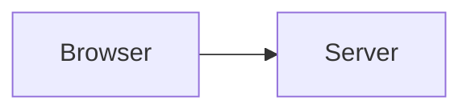

---

title: Layout and testing
description: Where things live, how to run every check, and how the tests are themselves tested.
---

# Layout and testing

## The repository

```text
packages/core   billing engine, rules, validation, bundle format, history sentences (pure TypeScript)
apps/api        Hono API for Node and Cloudflare Workers, Postgres migrations, tenant lifecycle
apps/web        the installable web app, the home page, and the generator for these documentation sites
apps/reference  the API reference, a site of its own: the server's routes as OpenAPI, shown with Scalar
docs            design record, promise ledger, runbook, and the source of the two documentation sites
scripts         checks that run in CI, and the live smoke tests
deploy          reverse-proxy configuration for the HTTPS Compose file
```

Dependencies point one way. `packages/core` imports nothing from the other two and does no input or
output, so the same rules run in the browser, on Node and in a Worker, and a test can run them with
no database. `apps/api` and `apps/web` import `@alimentation/core`; they never import each other.

### Where a rule lives

A rule that matters is written three times, on purpose
([The trust model](/docs/concepts/trust-model/)): in `packages/core` so a person is told before they
press the button, in the service in `apps/api/src/workspace/service.ts` so the server never trusts
the browser, and in a migration so the database holds even if the service is wrong. A change to a
rule changes all three and its tests.

### Migrations

SQL lives in `apps/api/migrations/{control,workspace}`, numbered `0001_name.sql`. A migration is
never edited after release; a change is a new file. Workers have no filesystem, so
`node scripts/embed-migrations.mjs` embeds the files into `apps/api/src/db/migrations.generated.ts`.
Run it after adding one; `--check` fails when the module is stale.

### The web app

The screens of a kitchen are listed once, in `apps/web/src/pages/workspace/sections.ts`: address,
name, group, and the roles that may open it. The menu, the routes and the "not for your role" answer
are all read from that list. Add a screen there and in `Shell.tsx`'s `VIEW` table. The server still
decides what each role may do; the list only decides what is shown.

## Running the checks

The whole suite, on the Postgres this project targets, in containers:

```console
docker compose -f compose.test.yaml run --rm test
```

That runs formatting, types, the promise ledger, the design checker and every test, with the
Postgres log readable so the check that no personal data reaches it runs for real.

Without Docker, have Node 24 or later (`.nvmrc` says 24) and a PostgreSQL 15 or later whose login
role can create roles and databases:

```console
npm install
export ALIMENTATION_TEST_PG=postgres://you@127.0.0.1:5432/postgres
npm run format:check
npm run typecheck
npm run promises
npm run design
npm test                 # unit and database tests
npm run test:e2e         # the app in a real browser, desktop and phone
npm run drift:db         # breaks each database guard on purpose
```

`ALIMENTATION_TEST_PG_LOG=/path/to/postgres.log` makes the Postgres-log check run. CI sets
`ALIMENTATION_REQUIRE_PG_LOG=1`, so there it cannot be skipped. The browser tests need Chromium:
`npx playwright install chromium`, or `PLAYWRIGHT_CHROMIUM_PATH` for one you already have.

## What each layer proves

| Layer                | Where                                                  | What it is for                                                                                                          |
| -------------------- | ------------------------------------------------------ | ----------------------------------------------------------------------------------------------------------------------- |
| Rules and billing    | `packages/core/test`                                   | Reference cases written by hand, property tests, boundary dates, and the bundle format. No database.                    |
| Service and database | `apps/api/test`                                        | The service on a real Postgres: row-level security, immutability, caps, the lifecycle, the HTTP surface.                |
| Web units            | `apps/web/src/**/*.test.ts`                            | Formatting, the section registry, the sample month, the documentation build, the design checker.                        |
| API reference        | `apps/api/test/openapi.test.ts`, `apps/reference/test` | The reference lists every route and error code the server has, and the site it is served from is read only.             |
| The app in a browser | `apps/web/e2e`                                         | A kitchen from its first day to its last, on a desktop and a phone, with accessibility and layout checks at each stage. |
| Deployment           | `scripts/smoke-compose.sh`, `smoke-worker.sh`          | The image that ships starts and serves; the Worker bundle runs in the Workers runtime.                                  |

### Tests that make promises

Each promise on the home page has an id in `docs/PROMISES.md`. A test proves a promise by carrying
its id in its name, for example `it('[P7] …')`. `npm run promises` fails if a promise has no test,
if a test names a promise that does not exist, or if the ledger and the home page disagree.
`npm run promises -- --write` refreshes the ledger's proof columns.

### Testing the tests

A test that would also pass without the thing it checks proves nothing. Two things ask that
question.

- **Mutation testing** of the engine, rules, validators, money and dates: `npx stryker run`. A small
  change nothing notices is a rule nobody checks. It takes several minutes, so it is not in CI; run
  it after changing the engine.
- **Database drift**: `npm run drift:db` removes each guard in turn (a policy, a privilege, a
  trigger, a cap) from a freshly made workspace database and requires the named test to fail. It
  reports a guard nothing checks as **MISSED**, one caught by the wrong test, and a control change
  that breaks nothing as a harness fault. To add a guard, add the migration, the test, and a line in
  `defects` in `scripts/drift-db.mjs`. See `docs/DRIFT.md`.

### Browser tests

`apps/web/playwright.config.ts` starts the built server against your Postgres with `AUTH_DEV=1`, in
two projects: `desktop` (1280 by 900) and `phone` (Pixel 7). Motion is reduced so that nothing is
measured halfway through a fade. The journey, layout and documentation specs run in both. They
check, among other things, that no page scrolls sideways at 320, 360, 390 and 430 pixels, that the
phone's bottom bar fits, and that each stage of the journey passes axe with no violations, with the
main screens checked again in the dark theme.

Playwright's phone emulation can keep a stale viewport width after a rotation. The layout tests set
the size, wait for it to take, and reload up to four times before measuring; when a page does
overflow, the failure names the offending element.

## CI

| Job      | What it runs                                                                                       |
| -------- | -------------------------------------------------------------------------------------------------- |
| `test`   | The compose test run above: format, types, promises, design and every test, Postgres log required. |
| `image`  | `scripts/smoke-compose.sh`: the shipped image sets itself up against a fresh Postgres and serves.  |
| `worker` | The Worker bundled as it would be deployed, and run in the Workers runtime against Postgres.       |
| `e2e`    | `npm run test:e2e` on desktop and phone, with the results uploaded when it fails.                  |

## Conventions

- **Money is integer paise.** Amounts are stored, added and compared as whole numbers; they become
  rupees only when shown.
- **Dates are the kitchen's own.** A date is `YYYY-MM-DD` in the kitchen's time zone; the
  conversions live in `packages/core/src/dates.ts`.
- **Words for people.** Messages are written for the person who reads them and say what to do next.
  They live in `packages/core/src/messages.ts` so the browser and the server say the same thing.
- **Comments say why**, not what. A comment that restates the next line is deleted.
- **No inline styles that decide how something looks.** See
  [Conformance](/docs/design/conformance/).

## Code and diagrams in the pages

A fenced block is more than text. Nothing here runs in the reader's browser: it is all done when the
pages are built, and the content-security policy still forbids inline style.

Code is highlighted, and numbered once it is six lines long, with the numbers in the margin where
they cannot be selected or copied. The block is the design system's
[code component](/docs/design/components/#code), with a copy button that shows when it is pointed
at.

````md
```ts
export const answer = 42;
```
````

A block can show lines of a real file, numbered as they are in it. It is empty: the lines come from
the file, and the build fails if the file or the lines are no longer there, so the page cannot say
something the code stopped saying.

````md
```ts file=packages/core/src/engine.ts#L28-L39

```
````

A **console** is not a **shell** script. A `console` block is a session at a terminal: a line that
starts with `$` is typed, and every other line is what came back. The prompt is drawn by the
stylesheet and is not text, so copying takes the commands alone, one after another, and nothing the
machine said. A `sh` block is a script or a snippet to put in a file, and has no prompt. The build
fails for a console block that has no command in it.

````md
```console
$ node cli.mjs keys:rewrap
{"currentKey":2,"workspaces":14,"stillOnOldKey":0}
```
````

A block with nothing in it fails the build too, because it is nearly always a fence left open or
left behind.

After the language come settings: `hl=2,4-5` marks lines, and `numbers` or `nonumbers` turns the
numbering on or off. A diagram is a `mermaid` block with a title, which is what a reader who cannot
see it is told:

````md

````

The languages are TypeScript, JavaScript, JSON, SQL, shell (`sh`, for scripts), console, YAML, CSS,
HTML, TOML, Dockerfile, Markdown and diff, by their usual names; any other is an error that lists
them. The diagram's text is under it, for anyone who cannot see it. The kinds that can be drawn are
flowcharts, state, sequence, class and entity-relationship diagrams, and XY charts. A diagram
carries no colours of its own: its nodes, lines and text take their colours from the design system's
tokens in `docs.css`, so it is right in both themes. The colours of highlighting are the `--code-*`
tokens.

## Writing these pages

The Markdown is in `docs/site/guides` and `docs/site/docs`. A page needs a place in its site's
`nav.json` (an unlisted file fails the build, so nobody is left with a page no one can find), a
`title` and a `description` in its front matter, and one `#` heading. The build also fails on a
broken link or `#section`, and on two pages with one title. `> [!NOTE]`, `[!TIP]`, `[!WARNING]` and
`[!IMPORTANT]` make callouts.

Each site opens on a front page: `index.md` with `layout: home` and no body. What it shows is that
site's `home.json`: a hero (`name`, `text`, `tagline` and one or two `actions` of kind `brand` or
`alt`) and three to six `features`, each a `title`, `details` and `link`. The build checks the shape
and the links. Anything written under the front matter, without a `#` heading (the hero is the
page's one heading), is shown after the cards. The two front pages leave it empty so they stay
minimal, and what used to sit there has a page of its own.

The guides are written for people who use a kitchen, so a test refuses technical words in them
(Postgres, API, Docker and the like) outside of code. Say it plainly, or put it in the docs and link
there.

- **Warnings are fixed, not silenced.** A deprecation notice, an audit finding or a size marker in a
  build or test log is a defect to resolve at its cause. Nothing is hidden with a flag, a filter or
  `--no-warnings`. Where the cause is a dependency we cannot change, the fix is a documented
  `overrides` entry that is removed when the dependency catches up. Today there is one:
  `workbox-build` asks for a `glob` that npm marks deprecated, so it is given `glob` 13 (the only
  call it makes, `globSync`, is unchanged).
- **Install scripts are approved by name and version.** `allowScripts` in `package.json` lists the
  two packages that run one (esbuild, workerd) at the version reviewed, and `vue-demi`, which Scalar
  pulls in for the API reference, as refused: its script only chooses which Vue build to link, and
  the reference ships Scalar's own built files. A bump asks again, and
  `npm install-scripts approve <package>` records the new version.
- **Import zod as a namespace** (`import * as z from 'zod'`). The named `{ z }` export keeps all
  sixty-odd language packs alive and added about 590 KB to the server bundle.
